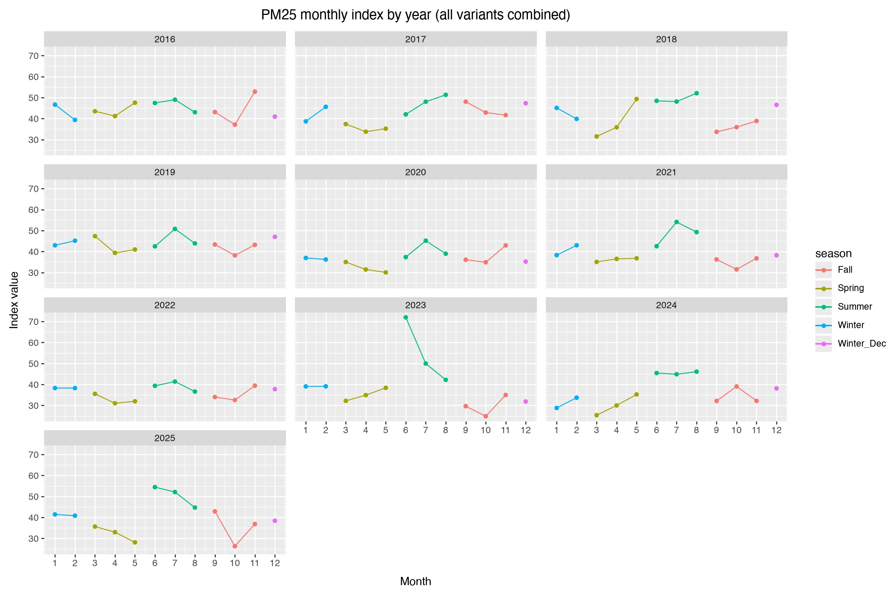

# Longevity of seasonal air pollutant trends within Pittsburgh

## Introduction

With growing concern about the state of the environment worldwide and the effects of climate change, government organizations and researchers are paying closer attention to how human activity contributes to natural disasters. This project focuses on one area of environmental study: Changes in the levels of various pollutants and how they are placed on the Air Quality Index (AQI). Using data analytics, we will break down large datasets and present visualizations of key trends, which can help us forecast and inform future actions.

## Background and Motivation

The Allegheny County Health Department (ACHD) is a local government agency in Western Pennsylvania. It oversees a range of public health areas, including daily pollutant readings across the Pittsburgh Metropolitan Area, with each monitoring site having its own ID and location assigned.

I became interested in this topic because of the dangerous pollutant levels I have experienced over the past five years, and I wanted to better understand how pollutant trends develop. I also wanted to challenge myself by working with a dataset independently, without instruction, and drawing a reasonable conclusion from it. This project gave me the chance to expand my analytical skills more broadly.

## Own Findings / Data Analysis Process

For this project I was set to answer this question:
### How do seasonal patterns differ among pollutants within Pittsburgh across a 10 year period?

I wanted to find out what I can put away from this question
#

This dataset contains pollutant readings recorded daily across Pittsburgh neighborhoods over a period of roughly 10¾ years. The earliest date in the dataset is January 1, 2016, and I downloaded the csv on September 10, 2026, which indicates that the data spans from January 1, 2016 to September 10, 2026. The dataset originally contained 8 columns and over 87,000 rows.

| Column | Type | Description |
|---|---|---|
| `_id` | integer | Row identifier |
| `date` | datetime | Gives the date of record |
| `site` | string | Gives the site of where the data was recorded |
| `parameter` | string | Title of the pollutant |
| `index_value` | integer | Pollutant level recorded |
| `description` | string | Determining if air is considered Good, Unhealthy, or Very unhealthy |
| `health_advisory` | string | Warning of dangerous air levels |
| `health_effects` | string | Describes health effects from dangerous air levels |

Before checking for duplicates, the dataset was already quite clean, as every row contained the same number of non-null values. Even after removing duplicate locations, and pollutant readings from 2026, the row counts remained balanced across columns. There were also no missing values NaNs to delete or fill in, excluding the description columns.
#
### Data Analysis Process

1) Reformat database "types" 
2) Deleting duplicates in the dataframe
3) Deleting partial year 2026 (To make it 10 years)
4) Adding months columns to dataframe
5) Grouping variant pollutants into a dictionary
6) Add a column to the original dataframe to organize variant pollutants with the pollutant they originate in (Dictionary)
7) Average each pollutant
8) Add months and seasons to plot dataframes
9) Plot each pollutant; We will use plotnine for visual plotting

## Results

For this analysis we looked at 6 pollutants, that all had bundled variants (coming from the dictionary), and we looked at the trends of each:

### PM2.5 Trends:

* Visually similar across most years, with a general flow. The model becomes more volatile from about 2022 - 2025.

#### Estimated Avg AQI Range
`Winter`: 40-48 aqi |
`Spring`: 35-50 aqi |
`Summer`: 40-55 aqi |
`Fall`: >30-45 aqi |

### PM10 Trends:

* Overall AQI is much lower. PM10 is the same pollutant as PM2.5 but a different particle size, so the two should correlate. It is somewhat consistent in the first few years, then very volatile in the last 4. The monthly table becomes hard to read because of the volatility.

#### Estimated Avg AQI Range
`Winter`: 10-25 aqi |
`Spring`: 15-23 aqi |
`Summer`: 21-27 aqi |
`Fall`: 17-27 aqi |

### CO Trends:

* Very consistent across all years, with 2025 the exception; still trendy, but more volatile. It is unusual because it has a low AQI but is still very consistent.

#### Estimated Avg AQI Range
`Winter`: 3-9 aqi |
`Spring`: 4-10 aqi |
`Summer`: 3-13 aqi |
`Fall`: 3-10 aqi |

### Ozone Trends:

* The highest AQI, and the most consistent pollutant. Eight years show the same bell-shaped seasonal curve, with low values in winter, values peaking in summer, and a decline through fall and winter.

#### Estimated Avg AQI Range
`Winter`: 21-36 aqi |
`Spring`: 37-47 aqi |
`Summer`: 42-50 aqi |
`Fall`: 24-43 aqi |

### SO2 Trends:

*  Another low AQI model, so the data looks distorted and volatile. Most years seem to trend downward, and the last 3 years show almost no similar trend.

#### Estimated Avg AQI Range
`Winter`: 7-13 aqi |
`Spring`: 5-16 aqi |
`Summer`: 8-15 aqi |
`Fall`: 8-18 aqi |

### NO2 Trends:

* Slightly higher AQI levels than SO2 but still on the low side. Second to CO among the low-AQI pollutants. It is somewhat consistent and easier to read than most. AQI starts a bit high in winter, plateaus in spring, falls into summer, and rises again in fall; which is the biggest jump.

#### Estimated Avg AQI Range
`Winter`: 16-23 aqi |
`Spring`: 13-17 aqi |
`Summer`: 13-16 aqi |
`Fall`: 15-19 aqi |

## Discussion & Recommendation

Reflecting on the results, several patterns stand out. Some pollutants tend to produce higher AQI values and others lower; The higher-AQI pollutants, such as ozone and PM2.5, follow a more organized and structured trend across the 10 years, while the lower-AQI pollutants, such as PM10 and CO, are more distorted and volatile. For roughly two-thirds of the 10 years, the trends for all pollutants follow a similar path; they are not identical, but they are close. Seasonally, each pollutant has its own AQI range and trajectory, and these differ in some years, with a few years standing out as outliers. Most notably, the data from the last few years, especially 2025, appears distorted or is beginning to become so. This suggests there may be more days with extreme pollutant levels, or more natural disasters contributing to the volatility.

Before making my recommendation, I should note that I am not an air quality specialist. I am an analyst who took a dataset and organized it into numerical and visual results for those who understand pollutants and other environmental factors. With that in mind, I recommend sending this analysis to the Allegheny air quality specialists so they can study the volatility of each pollutant by quarter over the past year. These recent outlier years, compared with the five years before them, are critical for forecasting. Studying them may help us project what is to come and decide what steps we need to take to reduce volatile and dangerous pollutant levels.

## Conclusion

## References
* Allegheny County Health Department, "Daily AQI Data", Western Pennsylvania Regional Data Center, September 10, 2026, https://data.wprdc.org/dataset/allegheny-county-air-quality/resource/4ab1e23f-3262-4bd3-adbf-f72f0119108b

